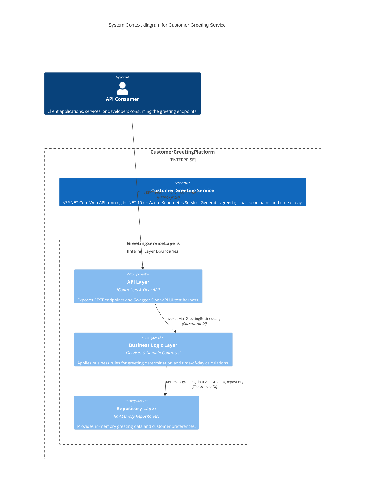

# Customer Greeting Service — Architecture

## System Diagram



## Tech Stack

- **Runtime & Language**: .NET 10, C# 13
- **Framework**: ASP.NET Core Web API (Controllers)
- **API Documentation & Test Harness**: OpenAPI / Swagger UI
- **Dependency Injection**: Microsoft.Extensions.DependencyInjection (Constructor Injection)
- **Data Storage**: In-Memory data store (interim phase)
- **Cloud Infrastructure**: Microsoft Azure, Azure Kubernetes Service (AKS)
- **CI/CD Platform**: Azure DevOps Pipelines
- **Test Frameworks**: Visual Studio Unit Testing (MSTest), Moq (no fluent assertion libraries)

## Layers

The application adheres to a strict 3-tier layered architecture where each layer exposes only interfaces and contract models to other layers:

1. **API Layer (`CustomerGreetingService.Api`)**:
   - Contains ASP.NET Core controllers handling HTTP requests and serializing responses.
   - Configures Swagger / OpenAPI middleware to supply an interactive test harness.
   - Acts as the application composition root where dependency injection bindings are registered.
   - Consumes only interfaces exposed by the Business Logic Layer.

2. **Business Logic Layer (`CustomerGreetingService.BusinessLogic`)**:
   - Defines and implements domain services (such as greeting calculation according to customer name and time of day).
   - Enforces business validation rules and encapsulates core domain workflows.
   - Exposes interfaces (`IGreetingBusinessLogic`) and data contracts for consumption by the API layer.
   - Consumes data access abstractions (`IGreetingRepository`) defined for the repository layer.

3. **Repository Layer (`CustomerGreetingService.Repositories`)**:
   - Implements data storage and access mechanisms.
   - In the initial phase, provides an in-memory repository implementation storing default greeting formats and configurations.
   - Exposes repository interfaces (`IGreetingRepository`) and data entities.
   - Designed for future substitution by persistent database providers (e.g., Azure SQL, Cosmos DB, or PostgreSQL) without changes to upper layers.

## Key Patterns

- **Layered Architecture with Strict Interface Encapsulation**: No layer directly references concrete implementations of adjacent layers; communication occurs strictly through public interface contracts.
- **Constructor Dependency Injection**: Dependencies are passed explicitly into class constructors, ensuring testability and lifecycle control.
- **Repository Pattern**: Abstract data access behind repository interfaces to isolate business logic from storage mechanisms.
- **OpenAPI Specification as Test Harness**: API capabilities are exposed via standardized OpenAPI metadata and Swagger UI for self-serve testing and integration.

## Source Code Layout

```text
src/
  CustomerGreetingService.Api/                     # Controllers, Program.cs, OpenAPI configuration
  CustomerGreetingService.BusinessLogic/           # Business logic interfaces, service implementations, DTOs
  CustomerGreetingService.Repositories/            # Repository interfaces, in-memory repository implementations, entities
tests/
  CustomerGreetingService.Api.UnitTests/           # MSTest suites with Moq for API controllers
  CustomerGreetingService.BusinessLogic.UnitTests/ # MSTest suites with Moq for business logic rules
  CustomerGreetingService.Repositories.UnitTests/  # MSTest suites for in-memory repository implementations
  CustomerGreetingService.ApiTests/                # Integration / WebApplicationFactory tests
```

## Data Flow

1. An external client application or OpenAPI test harness issues an `HTTP GET /api/v1/greetings?name={name}` request.
2. The `GreetingController` receives the request, validates input parameters, and invokes `IGreetingBusinessLogic.GetGreetingAsync(name, currentTime)`.
3. The `GreetingBusinessLogic` evaluates the current time-of-day interval (e.g., Morning: 05:00–11:59, Afternoon: 12:00–17:59, Evening: 18:00–04:59).
4. The `GreetingBusinessLogic` requests necessary greeting templates from `IGreetingRepository.GetGreetingTemplatesAsync()`.
5. The in-memory repository retrieves and returns the matching greeting template entity.
6. The `GreetingBusinessLogic` constructs the personalized greeting model and returns it to `GreetingController`.
7. The `GreetingController` packages the model into a standard HTTP 200 response with JSON payload.

## Cross-Cutting Concerns

- **Error Handling**: Standardized error responses using RFC 7807 Problem Details for 4xx and 5xx errors.
- **Logging & Diagnostics**: Structured logging using ASP.NET Core `ILogger` abstraction, outputting JSON logs to Azure Monitor / Application Insights.
- **Configuration**: Dedicated configuration classes for specific purposes (such as `GreetingConfiguration` and `TimeIntervalConfiguration`) injected directly via constructor injection, rather than generic `IOptions<T>`, ensuring purpose-built settings access without leaking framework option wrappers into business logic.
- **Health Checks**: Standard ASP.NET Core health endpoints (`/health/live`, `/health/ready`) for Kubernetes liveness and readiness probes.

## ADRs

<!-- adr-table:start -->
| ID | Title | Status | Date |
|----|-------|--------|------|
| [ADR-0001](decisions/ADR-0001-layered-architecture-interface-encapsulation.md) | Layered Architecture with Interface Encapsulation and Constructor Dependency Injection | accepted | 2026-03-24 |
| [ADR-0002](decisions/ADR-0002-in-memory-repository-pattern.md) | In-Memory Repository Pattern for Interim Data Access | accepted | 2026-03-24 |
| [ADR-0003](decisions/ADR-0003-aks-hosting-azure-devops.md) | Hosting on Azure Kubernetes Service (AKS) Deployed via Azure DevOps Pipelines | accepted | 2026-03-24 |
| [ADR-0004](decisions/ADR-0004-mstest-moq-testing.md) | Standardization on MSTest and Moq Without Fluent Assertion APIs | accepted | 2026-03-24 |
| [ADR-0005](decisions/ADR-0005-time-provider-abstraction.md) | Adoption of TimeProvider for Temporal Operations | accepted | 2026-03-24 |
<!-- adr-table:end -->

## Assumptions

<!-- assumption-list:start -->
- [ASSUME-0001](assumptions/ASSUME-0001-in-memory-storage-interim.md): In-Memory Repository Implementation as Interim Storage (unresolved)
- [ASSUME-0002](assumptions/ASSUME-0002-hello-world-connectivity-verification.md): Hello World Endpoint Serves as Baseline Connectivity Probe (unresolved)
- [ASSUME-0003](assumptions/ASSUME-0003-hello-world-stateless-unauthenticated.md): Hello World Endpoint Operates Without External Persistence or Authentication (unresolved)
- [ASSUME-0004](assumptions/ASSUME-0004-name-validation-control-characters.md): Unicode Recipient Names and ASCII Control Character Validation (unresolved)
<!-- assumption-list:end -->

The save_adr and save_assumption tools fill these lists. Do not edit between the markers.
